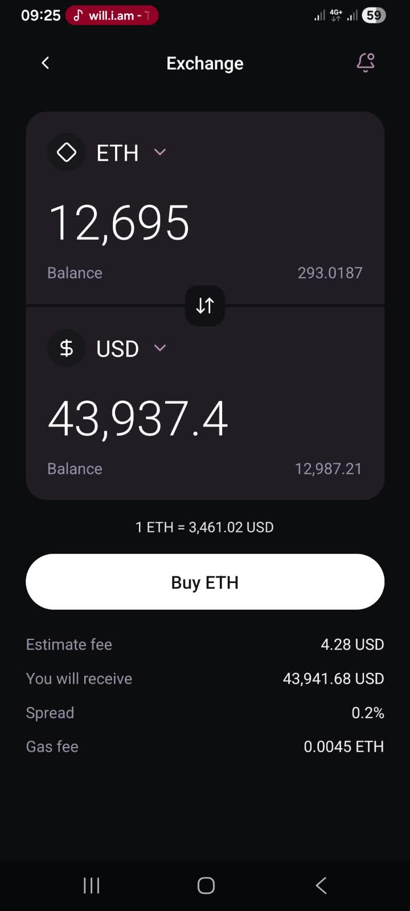
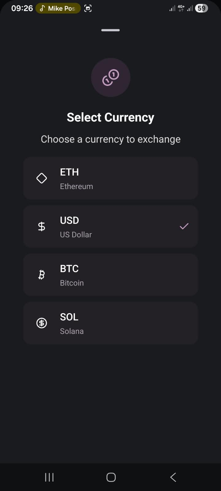
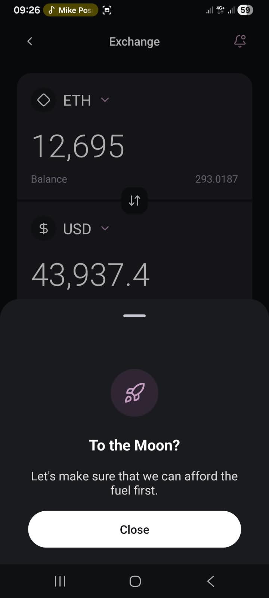
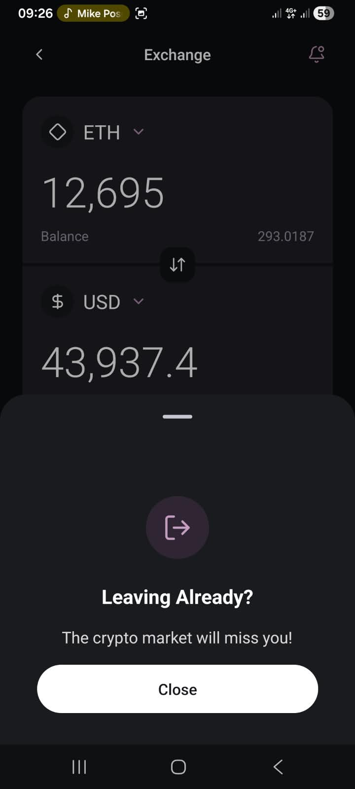

# Expo Native Exchange

A modern, responsive cryptocurrency exchange UI built with React Native, Expo, and TypeScript.

This project was developed for the **React Native Task 1 – UI Challenge**, focusing on accurate design replication, reusable components, interactivity, and responsive styling.

> **Note:** This is a UI demonstration project. It does not execute real cryptocurrency transactions or provide live market prices.

## App Preview

### Home Page:



### Currency Selection:



### Buy:



### Notifications:


### Back:



## Features

- Dark-themed cryptocurrency exchange interface
- ETH, USD, BTC, and SOL currency selection
- Interactive currency-switching functionality
- Reusable currency cards and action buttons
- Custom BottomSheet for:
  - Currency selection
  - Buy action confirmation
  - Notifications
  - Back-button interaction
- Lucide icons
- Hover and press feedback
- Responsive layouts for mobile and web
- TypeScript support

## Technologies Used

- **React Native** – Mobile UI development
- **Expo SDK 58** – React Native development framework
- **TypeScript** – Type-safe development
- **Expo Router** – Application routing
- **Expo UI** – Native BottomSheet implementation
- **Lucide React Native** – Icon library
- **React Native StyleSheet** – Component styling

## Download Android APK

The application is available as an installable Android APK.

**[Download APK – Google Drive](https://drive.google.com/drive/folders/1QpDIeYnO5TQlsEkKJKlIuq9zMnfrzmsw?usp=sharing)**

### Installation Instructions

1. Download the APK using the link above.
2. Open the downloaded APK on your Android device.
3. If prompted, allow installation from the source you used to open the APK.
4. Follow the installation instructions.
5. Launch **Exponative Exchange**.

**Note:** Android may display an installation warning because the APK is distributed outside the Google Play Store.

## Running the Project Locally

### Prerequisites

- Node.js and npm
- Git
- Expo Go or an Android development environment

### Installation

Clone the repository:

```bash
git clone https://github.com/surprise2024-cpu/exponative-exchange.git
```

Navigate into the project:

```bash
cd exponative-exchange
```

Install dependencies:

```bash
npm install
```

Start Expo:

```bash
npx expo start
```

Scan the QR code with Expo Go on a compatible Android device, or follow the terminal instructions to open the project on the web.

### Development Checks

Run TypeScript validation:

```bash
npx tsc --noEmit
```

Run Expo Doctor:

```bash
npx expo-doctor
```

## Reusable Components

The application uses reusable React Native components to improve readability and maintainability.

| Component      | Purpose                                              |
| -------------- | ---------------------------------------------------- |
| `CurrencyCard` | Displays currency information, amounts, and balances |
| `DetailRow`    | Displays transaction-related information             |
| `ActionButton` | Reusable button with hover and press feedback        |
| `BottomSheet`  | Reusable native sheet for multiple interactions      |

## Responsiveness

The interface is designed for different mobile screen sizes and web viewport widths.

Responsive techniques include:

- Flexbox layouts
- Maximum content width on larger displays
- Scrollable content for smaller screens
- Responsive spacing and alignment
- React Native StyleSheet styling

## Design and Functionality

The application replicates a cryptocurrency exchange design provided for the UI Challenge.

All currency balances, exchange rates, and transaction fees are demonstration values.

Currency selection changes the displayed currency information, but does not perform live exchange-rate calculations.

## Build Information

| Property      | Value    |
| ------------- | -------- |
| Platform      | Android  |
| Build profile | Preview  |
| Distribution  | Internal |
| Expo SDK      | 58       |
| App version   | 1.0.0    |
| Build format  | APK      |

The Android APK was generated using Expo Application Services (EAS Build).

## Academic Purpose

This project was developed as part of the **React Native UI Challenge**.

The implementation demonstrates React Native component development, reusable UI patterns, styling, user interaction, and responsive design.

## Author

**Surprise Nkosi**
